# Project Defense — Library Reservation System

## 1. Project Intent

The Library Reservation System manages readers, books, physical book copies, reservations, loans, and returns. The project defines a conceptual Entity-Relationship (ER) model describing the main entities, attributes, relationships, and cardinalities.

## 2. Main Entities

The model contains eight entities:

- Reader
- Author
- Category
- Book
- BookCopy
- Reservation
- Loan
- Librarian

## 3. Main Relationships and Business Rules

- Each Book has exactly one Author and one Category.
- One Author and one Category can be associated with many Books.
- One Book can have zero or many physical BookCopies.
- Reservations refer to individual physical copies.
- A Reader can have multiple active Reservations.
- A Reader and a BookCopy can each have only one active Loan at a time.
- Reservation and Loan are separate processes.
- Each Loan is processed by one Librarian and stores issue date, due date, return date, and status.

## 4. Model and Audit Verification

The conceptual ER model is documented in `model/er-model.mmd`. Its rendered diagram is available below.

The audit identified three discrepancies:

1. Reader phone attribute naming — standardized as `phone_number`.
2. BookCopy status attribute naming — standardized as `copy_status`.
3. Book–BookCopy cardinality — clarified to allow a Book to exist without physical copies.

The specification and ER model were updated to resolve these discrepancies. The active Loan restrictions are documented as business rules because basic ER cardinalities cannot fully represent them.

## 5. AI-Assisted Work

AI was used to review the specification and ER model, identify inconsistencies, and suggest corrections. Prompts, reconstructed response summaries, and personal feedback are documented in the `ai/` directory. Final modeling decisions were reviewed and approved by the project author.

## 6. Project Documentation

- `README.md` — project overview.
- `spec.md` — requirements and acceptance criteria.
- `model/` — ER model and rendered diagram.
- `adr/` — architectural decision records.
- `audit/` — model consistency audit.
- `ai/` — prompts, response summaries, and feedback.
- `DEFENSE.md` — project defense and verification results.

## 7. Scope

The project focuses on conceptual data modeling and requirements analysis. It excludes physical database implementation, SQL scripts, and application development.

## 8. Submission

- GitHub Repository: https://github.com/liza051/library-reservation-system
- GitHub Pull Request: https://github.com/liza051/library-reservation-system/pull/1